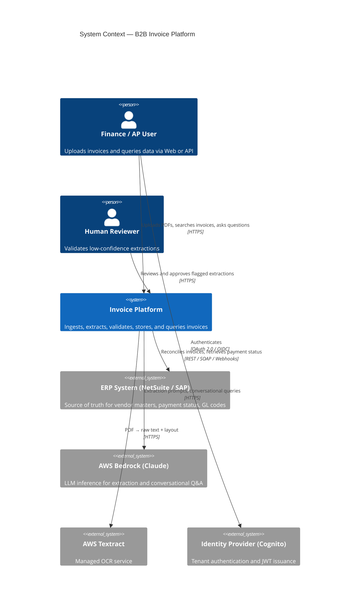
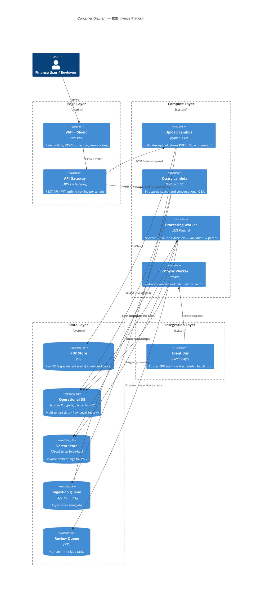
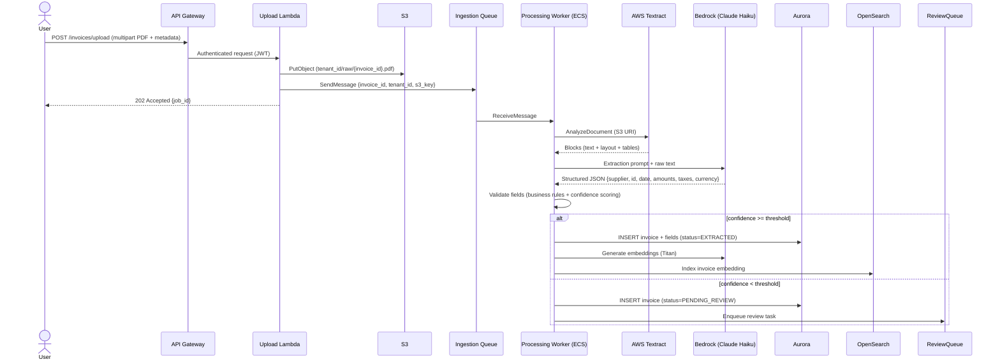
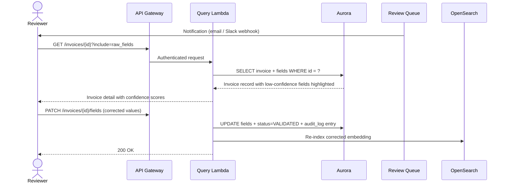
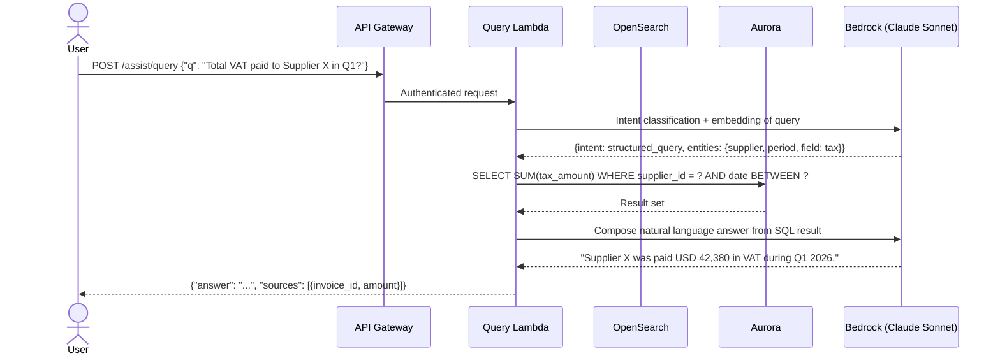
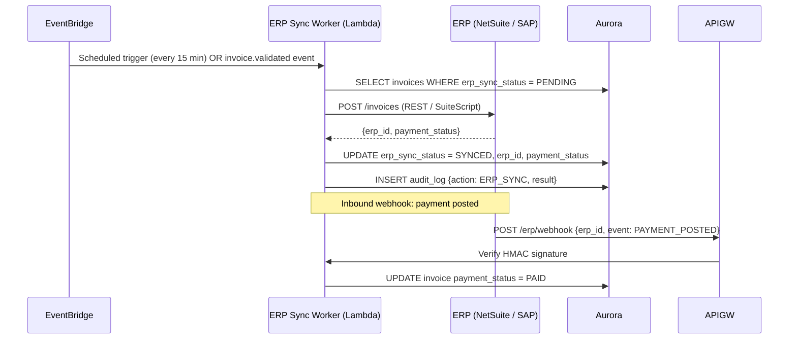

# System Design Document — B2B Invoice Processing Platform

> Version 1.0 · June 2026

---

## 1. Executive Summary

This document describes the architecture for a multi-tenant B2B invoice processing platform. The system ingests PDF invoices (supplier and customer), extracts and validates key fields using OCR and LLM-based information extraction, persists data in a relational store, exposes structured and conversational query APIs, and synchronises with external ERP systems (NetSuite / SAP).

**Design goals in priority order:**
1. Accuracy — ≥ 98% on totals/dates; ≥ 96% on taxes/currency; ≥ 95% on supplier ID
2. Reliability — SLOs met under peak load and 20% AI provider instability
3. Security — strict multi-tenant isolation, encryption, PII redaction, GDPR-compliant data residency
4. Cost efficiency — AI spend ≤ USD 18k/month at full scale

---

## 2. C4 Context Diagram



---

## 3. C4 Container Diagram



---

## 4. Sequence Flows

### 4.1 Invoice Upload and Extraction



### 4.2 Human Review Flow



### 4.3 Conversational Query



### 4.4 ERP Reconciliation



---

## 5. Data Model

### Core Tables (Aurora PostgreSQL)

```sql
-- Tenant registry
CREATE TABLE tenants (
    id          UUID PRIMARY KEY DEFAULT gen_random_uuid(),
    name        TEXT NOT NULL,
    region      TEXT NOT NULL,           -- e.g. 'eu-west-1' for data residency
    config      JSONB,                   -- tax schemes, currency defaults
    created_at  TIMESTAMPTZ DEFAULT NOW()
);

-- Invoice header
CREATE TABLE invoices (
    id              UUID PRIMARY KEY DEFAULT gen_random_uuid(),
    tenant_id       UUID NOT NULL REFERENCES tenants(id),
    invoice_type    TEXT NOT NULL CHECK (invoice_type IN ('SUPPLIER', 'CUSTOMER')),
    status          TEXT NOT NULL DEFAULT 'PROCESSING',
    -- PROCESSING → PENDING_REVIEW → VALIDATED → ERP_SYNCED
    confidence_doc  NUMERIC(5,4),        -- overall document confidence score
    s3_key_raw      TEXT NOT NULL,
    s3_key_redacted TEXT,
    created_at      TIMESTAMPTZ DEFAULT NOW(),
    updated_at      TIMESTAMPTZ DEFAULT NOW()
);

-- Extracted fields (one row per field per invoice)
CREATE TABLE invoice_fields (
    id              UUID PRIMARY KEY DEFAULT gen_random_uuid(),
    invoice_id      UUID NOT NULL REFERENCES invoices(id) ON DELETE CASCADE,
    tenant_id       UUID NOT NULL,
    field_name      TEXT NOT NULL,       -- supplier_name, invoice_id, date, total_amount, tax_amount ...
    raw_value       TEXT,               -- as extracted (before normalisation)
    normalised_value TEXT,              -- after currency/date normalisation
    confidence      NUMERIC(5,4),
    source          TEXT,               -- 'textract', 'llm', 'human'
    reviewed_by     UUID,               -- user who corrected this field
    reviewed_at     TIMESTAMPTZ
);

-- Immutable audit trail
CREATE TABLE audit_logs (
    id          BIGSERIAL PRIMARY KEY,
    tenant_id   UUID NOT NULL,
    invoice_id  UUID,
    actor_id    UUID,
    action      TEXT NOT NULL,          -- UPLOAD, EXTRACT, REVIEW, ERP_SYNC, EXPORT ...
    before_state JSONB,
    after_state  JSONB,
    created_at  TIMESTAMPTZ DEFAULT NOW()
) PARTITION BY RANGE (created_at);     -- monthly partitions

-- ERP sync tracking
CREATE TABLE erp_sync_jobs (
    id              UUID PRIMARY KEY DEFAULT gen_random_uuid(),
    tenant_id       UUID NOT NULL,
    invoice_id      UUID NOT NULL REFERENCES invoices(id),
    erp_type        TEXT NOT NULL CHECK (erp_type IN ('NETSUITE', 'SAP')),
    status          TEXT NOT NULL DEFAULT 'PENDING',
    erp_id          TEXT,
    payment_status  TEXT,
    attempts        INT DEFAULT 0,
    last_attempt_at TIMESTAMPTZ,
    payload         JSONB
);

-- Human review task queue (persisted, not just SQS)
CREATE TABLE human_review_tasks (
    id          UUID PRIMARY KEY DEFAULT gen_random_uuid(),
    tenant_id   UUID NOT NULL,
    invoice_id  UUID NOT NULL REFERENCES invoices(id),
    assigned_to UUID,
    reason      TEXT,                   -- which fields triggered review
    sla_due_at  TIMESTAMPTZ,
    resolved_at TIMESTAMPTZ,
    status      TEXT DEFAULT 'OPEN'
);
```

**Row-Level Security (RLS):**
```sql
ALTER TABLE invoices ENABLE ROW LEVEL SECURITY;
CREATE POLICY tenant_isolation ON invoices
    USING (tenant_id = current_setting('app.current_tenant')::UUID);
-- Same policy applied to invoice_fields, audit_logs, erp_sync_jobs, human_review_tasks
```

**Indexes (critical for SLO compliance):**
```sql
CREATE INDEX idx_invoices_tenant_status   ON invoices(tenant_id, status);
CREATE INDEX idx_invoices_tenant_created  ON invoices(tenant_id, created_at DESC);
CREATE INDEX idx_fields_invoice           ON invoice_fields(invoice_id);
CREATE INDEX idx_audit_tenant_invoice     ON audit_logs(tenant_id, invoice_id, created_at DESC);
```

---

## 6. Key Decisions and Trade-offs

| Decision | Choice | Rationale | Trade-off |
|----------|--------|-----------|-----------|
| Ingestion pattern | Async (SQS + ECS) | Decouples upload from processing; absorbs 20 PDF/s bursts; 202 response keeps P95 < 8s | Status polling / webhook adds client complexity |
| OCR engine | AWS Textract | Managed, handles tables/forms natively; AnalyzeExpense purpose-built for invoices | Higher per-page cost than open-source (Tesseract); vendor lock-in |
| LLM routing | Claude Haiku (primary) → Sonnet (fallback/review) | Haiku: low latency + cost for extraction; Sonnet: accuracy on complex/flagged docs | Two model versions to maintain |
| Multi-tenant isolation | RLS + per-tenant S3 prefix | Row-Level Security at DB layer is the strongest isolation without schema-per-tenant cost | RLS must be set in every DB session; more complex connection pool setup |
| Vector store | OpenSearch Serverless | Native AWS, no cluster management, integrates with IAM; sufficient for 150k/month | Less mature than Pinecone/Weaviate for hybrid search; no serverless cold-start issue at this scale |
| ERP integration | EventBridge + Lambda webhooks + batch fallback | Resilient: if ERP is unavailable, batch job catches up; EventBridge decouples routing | Eventual consistency — invoice status may lag ERP by up to 15 min |
| Data residency | Per-region CDK stack + Route 53 latency routing | Supports EU, US, APAC without code changes | More operational overhead; cross-region reporting requires careful design |

---

## 7. Reliability and SLO Compliance

### SLO Summary

| SLO | Target | Mechanism |
|-----|--------|-----------|
| Ingestion (upload → queued) | P95 < 1s | Synchronous only up to S3 PUT + SQS send |
| Extraction pipeline | P95 < 8s total | ECS worker processes median doc in ~4s; 8s budget allows Textract (~1.5s) + Haiku (~1s) + DB write (~0.5s) + buffer |
| Structured query | P95 < 400ms | Aurora read replica + PgBouncer + composite indexes + ElastiCache (hot tenant caches) |
| Conversational query | P95 < 2.5s | Haiku streaming + pre-computed embeddings; Sonnet only on explicit complex queries |

### Bedrock Instability (20% rate limit/timeout budget)

- **Circuit breaker** (per tenant): trip after 3 consecutive Bedrock failures; fall back to cached extraction template + human review queue
- **Retry with exponential backoff + jitter**: max 3 retries within 6s window
- **Model fallback chain**: Claude Haiku → Claude Sonnet → flag for human review (no silent failures)
- **SQS message visibility timeout**: 30s; failed messages return to queue automatically → DLQ after 3 attempts
- **DLQ alarm**: CloudWatch alarm fires if DLQ depth > 50 messages → PagerDuty

### Backpressure

- SQS FIFO queue with `maxReceiveCount = 3` before DLQ
- ECS Fargate auto-scales on `ApproximateNumberOfMessagesVisible` metric (target: 100 messages/worker)
- API Gateway per-tenant throttle: 50 RPS upload, 200 RPS query — prevents single tenant starving others

---

## 8. Cost Estimates

### AI / Inference (primary budget concern)

| Component | Volume | Unit price | Monthly cost |
|-----------|--------|-----------|-------------|
| AWS Textract (AnalyzeExpense) | 150k PDFs × 3 pages avg | $0.015/page | $6,750 |
| Textract (tables/forms) | Same as above | Already included | — |
| Bedrock Claude Haiku (extraction) | 150k docs × 1.5k input tokens | $0.25/1M input tokens | $56 |
| Bedrock Claude Haiku (output) | 150k × 300 output tokens | $1.25/1M output tokens | $56 |
| Bedrock Claude Sonnet (complex, 10%) | 15k docs × 3k tokens | $3.00/1M input | $135 |
| Amazon Titan Embeddings | 150k docs × 500 tokens | $0.0001/1k tokens | $8 |
| Conversational queries (est. 200k/month) | 200k × 2k input + 500 output | Mixed Haiku/Sonnet | $350 |
| **Total AI spend** | | | **~$7,355/month** |

> **Headroom: 59% of $18k budget** — leaves room for query volume growth 2.4× before budget is hit.

### Infrastructure (representative AWS costs)

| Component | Estimated monthly |
|-----------|-----------------|
| ECS Fargate (processing workers, avg 4 tasks) | $350 |
| Aurora PostgreSQL Serverless v2 | $400 |
| S3 (150k PDFs × avg 500KB + lifecycle) | $180 |
| OpenSearch Serverless (1 OCU min) | $175 |
| API Gateway + Lambda | $120 |
| SQS, EventBridge, CloudWatch | $80 |
| **Infrastructure subtotal** | **~$1,305/month** |

**Total platform cost: ~$8,660/month** at full design-load scale.

---

## 9. Security and Compliance

### Encryption
- **At rest**: S3 SSE-KMS (per-tenant KMS key); Aurora storage encryption with AWS-managed CMK; OpenSearch encrypted at rest
- **In transit**: TLS 1.3 enforced on all endpoints; VPC-internal traffic via PrivateLink to Textract and Bedrock
- **Application-level**: Sensitive fields (bank account numbers, PII) encrypted with `pgcrypto` in Aurora before insert

### PII Redaction
- After Textract extraction, a pre-persist step identifies PII categories (names, account numbers, VAT IDs) using Amazon Comprehend
- Redacted PDF stored in `s3://.../redacted/{invoice_id}.pdf`; original retained in `s3://.../raw/...` with S3 Object Lock for compliance period
- Redaction metadata logged in `invoice_fields` with `field_name = 'pii_redacted'`

### Multi-tenant Isolation
- RLS on all Aurora tables (set via `SET LOCAL app.current_tenant = '{tenant_id}'` in every DB session)
- S3 bucket policy + IAM conditions enforce `s3:prefix` per tenant
- Cognito user pools per tenant; JWT `custom:tenant_id` claim verified at API Gateway authoriser
- No cross-tenant queries possible at the application layer; DB-level RLS as hard backstop

### Data Residency
- CDK stack parameterised by region (`EU_WEST_1`, `US_EAST_1`, `AP_SOUTHEAST_1`)
- Tenant onboarding sets `region` in `tenants` table; Route 53 latency-based routing directs traffic to the correct regional stack
- Aurora Global Database with write forwarding disabled in secondary regions (read-only replica for DR, no cross-region write)
- Bedrock model invocations stay within the tenant's region; no cross-region inference

### Compliance Controls
- S3 Object Lock (compliance mode, 7-year retention) for original PDFs
- `audit_logs` table is immutable (append-only; no DELETE/UPDATE policy via DB role)
- GDPR right-to-erasure: personal data fields encrypted with per-user key; erasure = key deletion
- SOC 2 / ISO 27001 alignment through AWS Config rules + Security Hub standards

---

## 10. Observability Strategy

### Metrics (CloudWatch)
| Metric | Source | Alert threshold |
|--------|--------|----------------|
| `IngestP95Latency` | Custom metric from ECS worker | > 7s |
| `ExtractionConfidenceAvg` | Custom metric | < 0.90 for any tenant |
| `SQSDepth` | SQS ApproximateNumberOfMessages | > 5,000 |
| `DLQDepth` | SQS DLQ | > 50 |
| `BedrockErrorRate` | Custom metric | > 15% over 5 min |
| `QueryP95Latency` | API Gateway / X-Ray | > 350ms |
| `HumanReviewSLABreach` | Custom metric | Any task overdue > SLA |
| `MonthlyAICost` | Cost Explorer API | > $15,000 |

### Tracing
- AWS X-Ray end-to-end traces from API Gateway through Lambda → ECS → Textract → Bedrock → Aurora
- Custom trace segments for extraction pipeline steps (OCR, LLM call, validation, persist)
- OpenTelemetry SDK in ECS workers exports spans to X-Ray via ADOT collector

### Logging
- Structured JSON logs (correlation_id, tenant_id, invoice_id, step, duration_ms) → CloudWatch Logs
- Log groups per service with 90-day retention; archive to S3 Glacier after 90 days
- CloudWatch Logs Insights queries for per-tenant accuracy reports and error analysis

### Dashboards
- **Operational**: queue depth, worker throughput, error rates, P95 latencies
- **Accuracy**: rolling 24h extraction accuracy per field type per tenant
- **Cost**: daily AI spend vs monthly budget burn rate
- **ERP**: sync lag, webhook delivery rate, payment status reconciliation backlog
